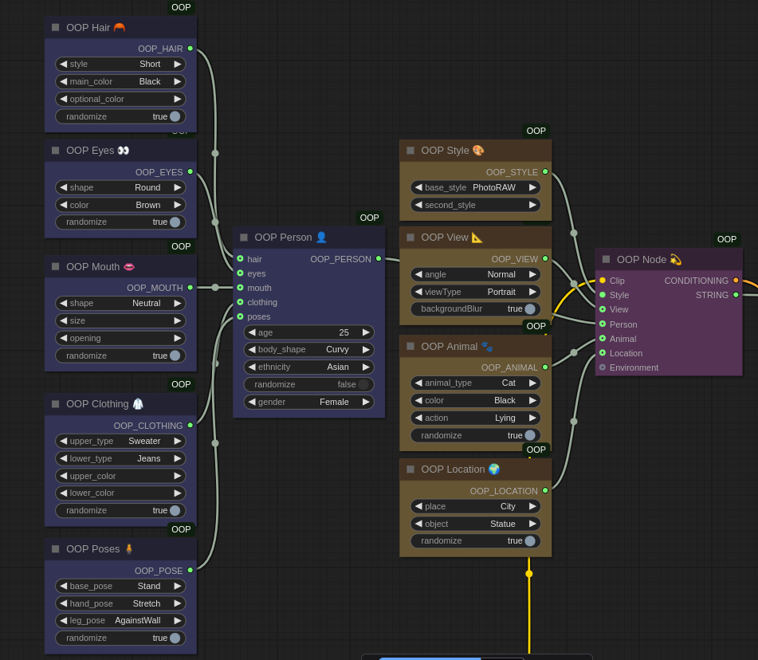
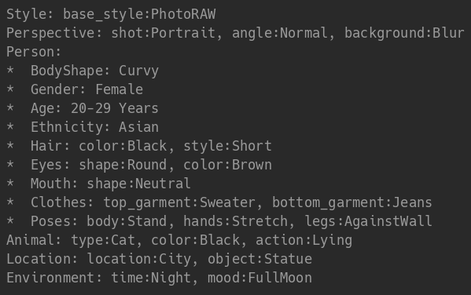

# ComfyUI OOP Nodes
This project contains a set of **ComfyUI OOP Nodes** that allow users to build detailed, object-oriented prompts with customizable visual attributes for characters, environments, and scenes. These nodes are designed to provide an intuitive way to generate and control different elements such as person attributes, hairstyles, eyes, locations, and poses. The **randomize** function allows for dynamic generation, enabling users to randomize different visual elements such as eye color, hairstyle, age, pose, animal, location and environment settings, providing endless possibilities for character creation and scene design.

## Features
Available Nodes



### OOP Hair Node 🦰
Allows customization of hair color, style, and optional secondary color.

### OOP Eyes Node 👀
Customizes eye shape and color with an option to randomize attributes.

### OOP Location Node 🌍
Generates scenes with customizable locations and objects, with randomization options.

### OOP Mouth Node 👄
Customizes mouth shape, size, and openness with randomization features.

### OOP Person Node 👤
Generates detailed person descriptions based on gender, age, body shape, ethnicity, hair, eyes, mouth, clothing, and poses.

### OOP Pose Node 🧍
Customizes poses with configurable body, hand, and leg poses, with randomization support.

### OOP Style Node 🎨
Combines visual styles like "Abstract", "Vintage", "Cyberpunk", "Watercolor", and more to create diverse art styles.

### OOP View Node 📐
Configures camera angles, shot types, and background blur effects for image generation.

### OOP Clothing Node 🥼
Generates a top and a bottom garment with their types and optional colors, with randomization support.

### OOP Animal Node 🐾
Generates an animal's type, color and action, with randomization support.

### OOP Environment Node ⛅
Sets the time of day and the scene mood, with randomization support.

### OOP Node 💫
Assembles every connected section into one structured prompt and encodes it into `CONDITIONING` (plus the raw `STRING`) using whatever text encoder the checkpoint provides, so it works for SDXL, SD1.5, Flux, Flux2, Flux3, Krea2, Ernie and any other model whose CLIP/text-encoder output you connect. Every section is optional, so disconnecting one drops its line. The `clip_skip` widget defaults to `0`, keeping the layer the checkpoint loaded (already `-2` on SDXL); only set it negative to re-encode CLIP-style encoders from another layer.

### Prompt Assembly
- Each leaf node emits `key:value` pairs joined with `, `; `OOPNode` prefixes each section with its label (`Style:`, `Perspective:`, `Person:`, `Animal:`, `Location:`, `Environment:`) and joins the sections with newlines.
- `OOPPersonNode` nests its details as bullet lines (`*  `), so the person block sits under `Person:`.
- The first entry of every dropdown is a single space (`" "`), meaning "no value": that pair, or an entire section, is left out of the prompt.
- Keeping **randomize** off holds the values steady; turning it on redraws them on every run.

### Requirements
Python 3.x
ComfyUI (This set of nodes is designed to be used in the ComfyUI environment)
#### Installation

    cd custom_nodes

Clone the repository:

    git clone https://github.com/0xRavenBlack/ComfyUI-OOP

Restart ComfyUI to load the new nodes.

#### Demo workflow dependencies
The saved graph in `workflow/ComfyUIOOP.json` uses nodes that are **not** part of this package, so it only loads once they are installed too:

| Node in the graph | Where to get it | Core replacement |
|---|---|---|
| `SDXL Quick Empty Latent (WLSH)` | [wallish77/wlsh_nodes](https://github.com/wallish77/wlsh_nodes) | `Empty Latent Image` |
| `ShowText|pysssss` | `comfyui-custom-scripts` (Comfy Registry) | `Save Text` |
| `CheckpointLoaderSimple`, `CLIP Text Encode`, `KSampler`, `VAEDecode`, `PreviewImage`, `Conditioning Zero Out` | shipped with ComfyUI | — |

The OOP nodes themselves need no extras: only the example workflow does.

#### Example
For example, consider the following prompt using the new OOP syntax:
```
    Style: base_style:PhotoRAW
    Perspective: shot:Portrait, angle:Normal, background:Blur
    Person: 
    *  BodyShape: Curvy
    *  Gender: Female
    *  Age: 20-29 Years
    *  Ethnicity: Asian
    *  Hair: color:Black, style:Short
    *  Eyes: shape:Round, color:Brown
    *  Mouth: shape:Neutral
    *  Clothes: top_garment:Sweater, bottom_garment:Jeans
    *  Poses: body:Stand, hands:Stretch, legs:AgainstWall
    Animal: type:Cat, color:Black, action:Lying
    Location: location:City, object:Statue
    Environment: time:Night, mood:FullMoon
```

The same prompt as rendered in ComfyUI: 

#### License
This project is licensed under the MIT License - see the LICENSE file for details.

#### Contributing
If you wish to contribute to this project, feel free to fork the repository and submit a pull request with your improvements!
